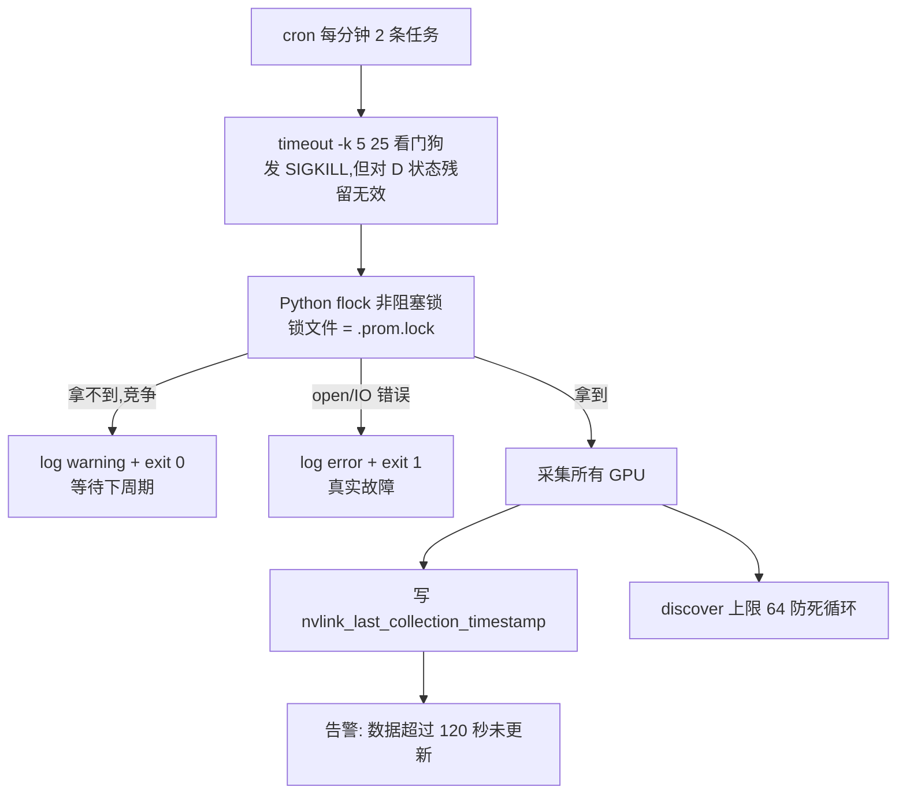

# NVLink Collector 挂死风险防御方案(Grill-me 设计文档)

> 状态:设计已定稿(含交叉审查修正),待实施
> 来源:2026-09-01 grill-me 会话逐分支钻取 + 双人独立审查(对方 + 我方)交叉核对合并
> 背景:生产环境由 crontab 每分钟双任务调度 `nvlink_collector --once`,担忧单次执行挂死后进程堆积

## 1. 风险结论

**卡住风险真实存在,且会越积越多。** 三个独立故障模式:

### 模式 1:单次执行挂死
- 所有 `pynvml` 调用是 ctypes 直通 `libnvidia-ml.so` 的 ioctl,驱动/GPU 异常态(ECC 风暴、GPU hang、驱动 bug)可导致**无限阻塞**
- `signal_handler()` 在 ctypes 调用阻塞期间**不会执行**(Python 信号只在字节码边界处理),SIGTERM 杀不动卡死进程
- `discover_nvlink_count()` 的 `while True` 无上限,驱动 bug 场景理论上死循环

### 模式 2:进程堆积
- cron 每分钟 2 条任务(0s 一条、`sleep 30` 一条),**无单实例锁**
- 挂死后每分钟净增 2 个进程(PyInstaller 二进制每个 RSS ~50MB),一天 ~2880 个 → 内存耗尽 + 反复 `nvmlInit` 加大驱动压力

### 模式 3:监控盲区(静默失败)
- 挂死时 `write_prom_file()` 未执行,`.prom` 停留在旧数据
- `nvlink_scrape_error` 恒为 0,现有 `NVLinkScrapeError` 告警**完全检测不到挂死场景**

## 2. 防御架构:三层正交



| 层 | 手段 | 防御的故障 |
|---|---|---|
| 看门狗 | cron 行 `timeout -k 5 25` | 单次执行挂死(模式 1),但不保证 D 状态残留场景 |
| 单实例锁 | Python `fcntl.flock()` 非阻塞 | 进程堆积(模式 2) |
| 新鲜度指标 | `nvlink_last_collection_timestamp` | 监控盲区(模式 3) |
| 循环上限 | `MAX_LINKS=64` | discover 死循环 |

## 3. 关键设计决策(含钻取中修正的坑 + 交叉审查修正)

### 3.1 看门狗:`timeout -k 5 25`,必须带 `-k`——但存在已知残余风险

**用户态信号链路:已实证成立,但有版本依赖**
用与生产相同的 Ubuntu 22.04 + amd64 + PyInstaller 6.22.2 onefile 构建做过实验:SIGKILL 杀掉 bootloader 父进程后,子进程经 `PDEATHSIG` 机制随之死亡,`fcntl.flock` 持有的锁被内核释放。链路本身没问题,**但这个行为依赖 PyInstaller 版本实现细节,升级 PyInstaller 版本后必须重新验证**(见 §4 验证清单第 4 步)。

**内核态残留风险(唯一真正的残余风险,必须明示)**
若子进程卡在**不可中断睡眠(D 状态)**——这是驱动级硬件 hang 的典型态——父进程死亡时 `PDEATHSIG` 发出的 SIGKILL 同样对 D 状态进程不生效,`kill -9` 打不动。此时锁被永久持有,后续 cron 任务全部 `exit 0` 跳过,`.prom` 永久陈旧。

这是**可接受的降级**:不会继续堆积新进程,`NVLinkMetricsStale` 告警会持续响,不会被误判为"已恢复"。但必须在 README 故障排查里显式给出人工介入路径(见 §4 清单第 6 项、§6)。

- 25s = 正常耗时 5s 的 5 倍余量(用户确认生产最大节点单次采集 ~5s 内)
- 看门狗必须在进程外部:Python 内部 `signal.alarm()` 救不了 ctypes 阻塞中的自己

### 3.2 单实例锁:Python 层独占,cron 层**不加** flock

- ~~cron 行 `flock -n lockfile timeout ...`~~(会话中自我修正的设计错误)
- **原因**:cron 的 flock 先持锁 → Python 再对同一文件 `fcntl.flock()` 必然失败 → 每次采集都被跳过,比原问题更糟(flock 绑定 open file description,两次 `open()` 互斥)
- **正确做法(完整规格)**:
  - 锁职责统一归 Python,加锁前先确保目录存在:`os.makedirs(os.path.dirname(output_path), exist_ok=True)`(复用 `write_prom_file()` 里已有的目录创建逻辑,提前到加锁之前调用,否则全新环境/目录被误删时 `open()` 会直接失败)
  - `fd = open(lock_path, "a")` → `fcntl.flock(fd, LOCK_EX | LOCK_NB)`
  - 锁文件 = `output_path + ".lock"`(与 `.prom` 同目录,权限天然匹配;手动测试 `/tmp` 路径自然不干扰生产锁)
  - **失败分两种语义**,不能混为一谈:
    - 锁竞争(`BlockingIOError`/`OSError EWOULDBLOCK`)→ log warning + `exit(0)`(跳过不是错误,等下周期)
    - `open()`/IO 错误(磁盘满、目录只读等)→ log error + `exit(1)`(真实故障;此时 `.prom` 本身也写不了,staleness 告警自然覆盖,不需要额外处理)
  - 挂死进程被杀后锁由内核自动释放(前提是子进程真正死亡,见 §3.1 的 D 状态例外)
  - Python 启动 1-2 秒的无锁窗口无害(尚未开始采集和写文件)

**cron 邮件/日志去向(单独决策点,不要和 exit code 混为一谈)**
`exit(0)` 本身是对的(跳过不是错误),但"避免 cron 报错邮件"这个理由不成立——cron 发邮件的触发条件是**任务有 stdout/stderr 输出**,与退出码无关。锁竞争的 warning 走 stderr,每次竞争都会触发一封邮件;而且这是存量问题(现有的 INFO 日志同样每次运行都进 stderr,只是目前没人注意)。实施时二选一:
1. cron 行尾追加 `>> /path/to/log 2>&1`
2. crontab 头部加 `MAILTO=""`

`exit(0)` 的正确理由改写为:**避免被外部失败监控(如 cron 自身的失败探测、systemd 邮件等)误报为任务失败**,而不是"避免 cron 报错邮件"。

### 3.3 新鲜度指标:单独 gauge,不用行尾时间戳

- **采用**:单独 metric `nvlink_last_collection_timestamp`,gauge 类型,值 = `time.time()` epoch 秒
- **不采用**:行尾毫秒时间戳后缀。原因:
  1. textfile collector 生态标准是不带行尾时间戳(样本入库时刻 = node_exporter 抓取时刻)
  2. 告警表达式 `time() - nvlink_last_collection_timestamp > 120` 要求 epoch 值参与运算
  3. staleness 机制恰恰依赖"不带时间戳":管线活着 → 值最新;管线死了 → 值冻结,`time() - value` 持续增大
- **前提依赖**:该告警族要求采集节点与 Prometheus server 的 NTP 时钟同步——若两端时钟偏移超过 120s 会导致误报,需在 README 里注明。

### 3.4 语义:"最后一次采集尝试",成功失败均更新

- **刻意不用"最后一次成功采集"**:否则错误路径不更新 timestamp,驱动坏和管线死混在一起同时触发两条告警,丢失区分度
- timestamp 回答**"采集管线还活着吗"**,scrape_error 回答**"采集成功了吗"**——两个正交信号
- **错误路径也必须写**(会话中发现的残余盲区):`write_error_prom()` 原本整个替换 `.prom` 为只含 scrape_error=1 的三行,timestamp 从文件消失 → staleness 告警哑火。修正:错误路径同样写入 timestamp

### 3.5 告警矩阵

| 故障场景 | scrape_error | timestamp 新鲜度 | 触发告警 |
|---|---|---|---|
| 驱动坏/无 GPU,进程活着 | 1 | 新鲜 | `NVLinkScrapeError` |
| 进程挂死/cron 失效/磁盘满 | 不更新 | 陈旧 | `NVLinkMetricsStale` |
| 两者同时发生 | 陈旧的 1 | 陈旧 | 两条都响 |
| `.prom` 文件被删/全新部署失败 | 指标不存在 | 指标不存在(不是"陈旧",是"缺失") | `NVLinkMetricsMissing`(见 §5) |

### 3.6 `write_error_prom()` 目标形态

```prometheus
# HELP nvlink_scrape_error Indicates scrape error: 1=error, 0=success
# TYPE nvlink_scrape_error gauge
nvlink_scrape_error 1
# HELP nvlink_last_collection_timestamp Unix timestamp of last collection attempt
# TYPE nvlink_last_collection_timestamp gauge
nvlink_last_collection_timestamp 1756716000
```

### 3.7 非目标(显式排除,避免误解为本轮顺带修好)

`collect_all_metrics()` 现有行为:某个 GPU 取信息失败时设置 `has_error = True` 但不 `return`,循环继续采集其余 GPU,最终仍返回非 `None` 的渲染内容;而 `main()` 只要 `has_error` 为真就整体调用 `write_error_prom()`,**把已经采集成功的其它 GPU 数据也一起丢弃**,只留 3 行错误状态。

这是**既有 bug,与挂死防护正交,本方案不处理**,后续应另立 issue 跟踪(方向大致是:`write_error_prom()` 不应整体覆盖,而应在已有 `MetricCollector` 内容基础上追加/更新 `scrape_error`)。在此明示,避免实施者误以为这轮改完顺带修好了 partial-failure 场景。

## 4. 实施清单

### 代码:nvlink_collector.py(5 项)
1. 新增 `acquire_lock()`,完整规格见 §3.2:先 `os.makedirs` 确保目录存在,再 `open()` + `fcntl.flock(LOCK_EX | LOCK_NB)`;锁竞争与 open/IO 错误分别处理(`exit(0)` vs `exit(1)`);`main()` 集成
2. `collect_all_metrics()` 增加 `nvlink_last_collection_timestamp` gauge 指标(值 = `time.time()`)
3. `write_error_prom()` 同步写入 `nvlink_last_collection_timestamp`(错误路径也更新)
4. `discover_nvlink_count()` 增加 `MAX_LINKS=64` 循环上限,**命中上限时 `logging.error()` 显式记录**(或输出 `nvlink_discover_truncated` gauge),不要静默截断——量纲上 64 余量充足(H100 实测 18 links),纯粹是可观测性要求
5. cron 邮件根因修正见 §3.2:实现 warning/error 日志时同步确认 §4 install.sh 清单第 6 项的日志重定向落地,避免锁竞争产生邮件噪音

### install.sh(2 项)
6. 两条 cron 任务行加 `timeout -k 5 25` 看门狗,**只包裹二进制调用本身**,确切内容:
   ```
   * * * * * timeout -k 5 25 ${INSTALL_DIR}/${BINARY_NAME} --once --output ${PROM_OUTPUT_PATH} # ${CRON_MARKER}
   * * * * * sleep 30; timeout -k 5 25 ${INSTALL_DIR}/${BINARY_NAME} --once --output ${PROM_OUTPUT_PATH} # ${CRON_MARKER}
   ```
   注意:`timeout` 不能包住 `sleep 30`,否则超时窗口与 sleep 叠加,统计口径错乱。
   时序备注(可选优化):`-k 5 25` 的 SIGKILL 落在任务启动后 30s,恰好撞上另一条任务的启动时刻,后果无害(拿不到锁就跳过一个周期,远低于 120s 告警阈值),但若想彻底解耦时序可改为 `-k 5 20`。
   同时在 crontab 头部加 `MAILTO=""`,或改为行尾追加日志重定向,避免锁竞争 warning 产生邮件噪音(见 §3.2)。
7. `uninstall()` 补充删除 `${PROM_OUTPUT_PATH}.lock`(目前只删二进制和 `.prom`,遗漏锁文件)

### README.md(1 项,展开为 3 个子项)
8. 补充新指标文档、`NVLinkMetricsStale` + `NVLinkMetricsMissing` 告警规则、NTP 时钟同步依赖说明;故障排查新增两条:
   - 挂死/锁检查(常规场景:`ps aux | grep nvlink_collector` 找到卡住进程,检查 `.lock` 是否被持有)
   - **D 状态无法 kill 的场景**:`NVLinkMetricsStale` 持续报警且 `ps` 显示采集进程状态为 `D`、`kill -9` 无效时,不要被动等待 timeout 生效——需人工介入(重启节点或 GPU 复位),因为该场景已知无法通过软件层解决

### 构建与分发(2 项)
9. 运行 `build_binary.sh` 重建二进制
10. 运行 `pack_installer.sh` 重新生成自解压安装包

### 验证(1 项,展开为 4 步)
11. 测试机验证,分四步(下述第 5 条为不可测项补充说明,不计入步骤),**不用 plain `sleep` 模拟挂死**(生产二进制是 PyInstaller onefile 的 bootloader 父进程 + Python 子进程双进程结构,plain sleep 测不到父子信号传递链路这个真实风险点):
    1. **锁竞争跳过**:helper 进程占住 `.lock` → 运行二进制 → 期望 warning + `exit 0`,`.prom` 不变
    2. **看门狗杀链**:用与生产相同方式构建的挂死 onefile 测试二进制(或用生产二进制 + `strace`/`gdb` 挂住 NVML 调用),跑 `timeout -k 5 25` → 验证子进程死亡 + `flock` 内核释放
    3. **staleness 链路**:停 cron 或冻结 `.prom` → 验证 `NVLinkMetricsStale` 触发;删除 `.prom` → 验证 `NVLinkMetricsMissing` 触发
    4. **回归**:升级 PyInstaller 版本后必须重跑第 2 步(见 §3.1,父子进程信号传递依赖 PyInstaller 版本实现细节)
    5. D 状态场景本身**不可在测试环境模拟**,属于已知不可测项,靠告警持续报警兜底,不强求测试覆盖

## 5. 新告警规则(加入 README 告警建议)

```yaml
# 采集管线挂死/停更(进程被 timeout 杀、cron 失效、磁盘满等)
- alert: NVLinkMetricsStale
  expr: time() - nvlink_last_collection_timestamp > 120
  for: 1m
  labels:
    severity: warning
  annotations:
    summary: "NVLink metrics are stale"
    description: "The .prom file has not been updated for over 2 minutes. Check cron jobs, hung processes (ps aux | grep nvlink_collector), lock files and disk space. If the process is stuck in D state and kill -9 has no effect, this indicates a kernel-level driver hang — manual intervention (node reboot or GPU reset) is required."

# .prom 文件被删除/全新部署失败/指标从未产生(absent 场景与 stale 场景互补,避免盲区)
- alert: NVLinkMetricsMissing
  expr: absent(nvlink_last_collection_timestamp)
  for: 2m
  labels:
    severity: warning
  annotations:
    summary: "NVLink metrics are missing"
    description: "nvlink_last_collection_timestamp metric does not exist. Check whether the .prom file exists and node_exporter textfile collector is configured correctly."
```

> 注:以上两条告警均依赖采集节点与 Prometheus server 的 NTP 时钟同步,时钟偏移超过 120s 会导致误报,部署前需确认。
>
> 注:`absent()` 仅在**集群所有节点**都不上报该指标时触发——单节点指标缺失不会告警。多节点部署若需检测"个别节点缺失",应改用 `unless` 模式:`up{job="node"} == 1 unless on(instance) nvlink_last_collection_timestamp`(job 名按实际环境调整)。另外 `absent()` 依赖 Prometheus 5 分钟 staleness 窗口,指标消失后需 ~5 分钟才可检测,叠加 `for: 2m` 总检测延迟约 7 分钟,属预期行为。

## 6. 已知限制(必读,写入 README)

D 状态残留风险(详见 §3.1):看门狗的 SIGKILL 依赖被杀进程处于可中断状态。若驱动/GPU 发生硬件级 hang,采集进程可能卡在不可中断睡眠(D 状态),此时 `kill -9`(无论是 `timeout -k` 直接发送还是通过 `PDEATHSIG` 间接触发)均不生效,锁会被永久持有。

这不是本方案的设计缺陷,而是 Linux 内核信号机制的基本限制,任何用户态方案都无法绕过。本方案的应对策略是**优雅降级**而非"彻底解决":
- 不会继续堆积新进程(锁机制生效,后续任务全部跳过)
- 不会误判为"已恢复"(`NVLinkMetricsStale` 持续报警)
- 需要人工介入才能恢复(重启节点或 GPU 复位)
